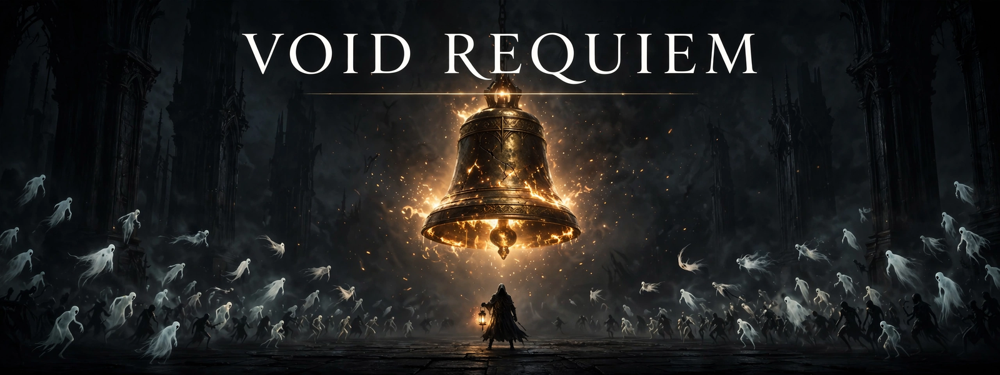
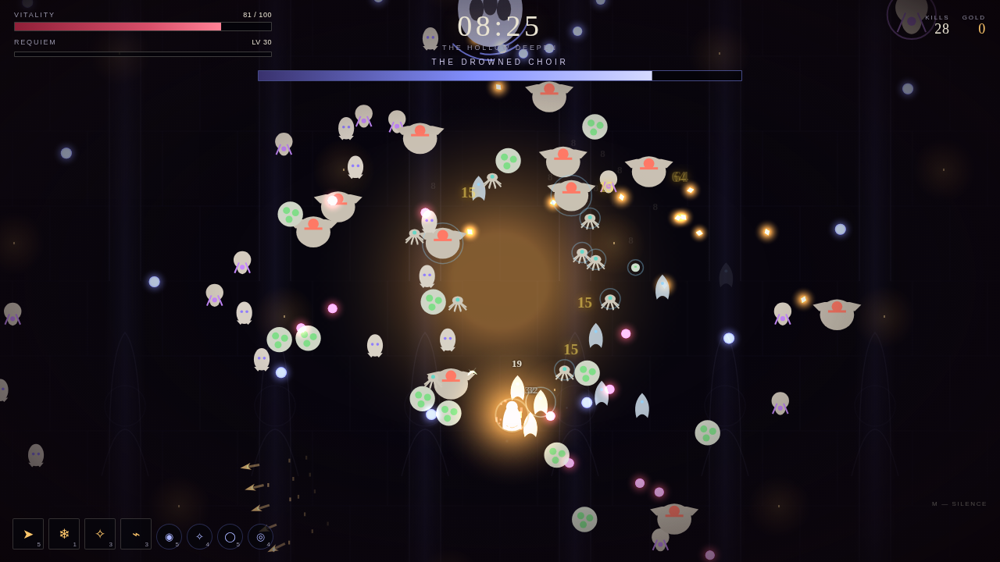
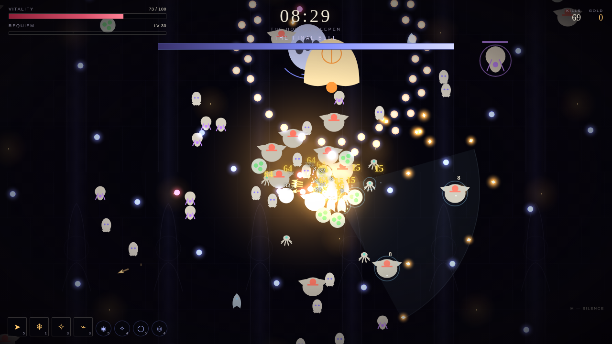
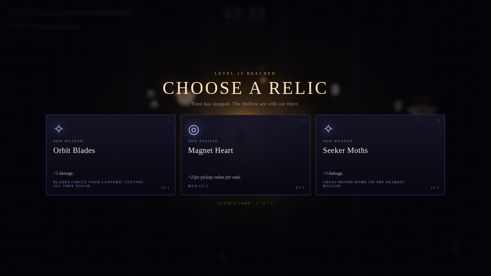

# VOID REQUIEM

**A bullet-heaven arena survival game in ONE HTML file.**

### ▶ [Play it now](https://vyva360-byte.github.io/void-requiem/)

No install, no server, no downloads. Open the page and survive.

---

## About the game

The void is ringing, and everything in it is coming for you. VOID REQUIEM drops you alone into an arena that fills with the dead — your weapons fire on their own, so the game is pure movement: positioning, greed, and knowing when to run.

Collect XP from the fallen, draft new weapons and passives, and build toward a golden evolution. Survive the escalating swarm for 20 minutes, face the bosses that toll along the way, and when **THE FINAL BELL** rings at 20:00 — kill it. That's the only way out.

Between runs, spend the gold you carried out on permanent upgrades and go back in stronger. Death is tuition.

## Screenshots

*Ringed by the Hollow — positioning is the whole game.*

*THE FINAL BELL, mid-barrage. It tolls for you.*

*The draft — time stops. The Hollow doesn't.*

## How to play

- **Move:** WASD or arrow keys — on touch devices, a floating virtual joystick
- **Weapons fire automatically.** Your job is where you stand and what you pick
- **Level up** and draft 1 of 3 cards: carry up to **4 weapons + 4 passives**, each up to level 5
- **Evolve:** a level-5 weapon paired with its matching passive ascends to a golden evolution — six exist
- **Bosses** toll at 5:00, 10:00, and 15:00. **THE FINAL BELL** arrives at 20:00 — killing it is victory
- **Meta upgrades:** gold buys permanent power across six upgrade tracks, plus reroll charges for your drafts

## What's inside

- **6 weapons** with distinct behaviors and level-5 specials, **6 golden evolutions**, **8 passives**
- **7 enemy types** — swarming Husks, darting Skitters, tank Brutes, ranged Spitters, Splitters that burst into Minis, phasing Wraiths — plus timed elite variants
- **4 bosses** with telegraphed, multi-pattern attacks and on-screen HP bars
- **A minute-by-minute wave director** that keeps escalating, climaxing in the 13–19 minute "long dark" surge
- **Full game feel:** screen shake, hitstop, floating damage numbers, crits, a streak counter, low-HP vignette
- **Synthesized sound:** all SFX and ambience are generated live with WebAudio — there are no audio files
- **Persistent progression:** gold, upgrades, and lifetime stats saved in your browser

## Difficulty

| Mode | What changes |
|---|---|
| **CHILL** | Gentler scaling, fewer enemies at once — learn the requiem |
| **STANDARD** | The game as written |
| **BRUTAL** | Harder multipliers across enemy HP, damage, spawns, and concurrency |
| **REQUIEM** | The full sentence. You start at 75 HP. Good luck |

Enemy HP, damage, speed, spawn rate, XP value, and the concurrent-enemy cap all scale by difficulty — and keep scaling every minute you stay alive.

## Tech notes

- **Single file, zero dependencies.** No frameworks, no external scripts, stylesheets, fonts, or images — everything is drawn and generated in code at runtime
- **Built for load:** object pools for enemies, projectiles, particles, and damage numbers; a spatial hash for collisions; canvas-only rendering — designed to hold 60 fps with 300+ live enemies
- **Runs anywhere:** any modern browser, desktop or mobile
- The full game is also in this repo as [`void-requiem.html`](void-requiem.html) if you'd rather download it and play offline

---

*Survive 20 minutes. Ring the Final Bell.*
